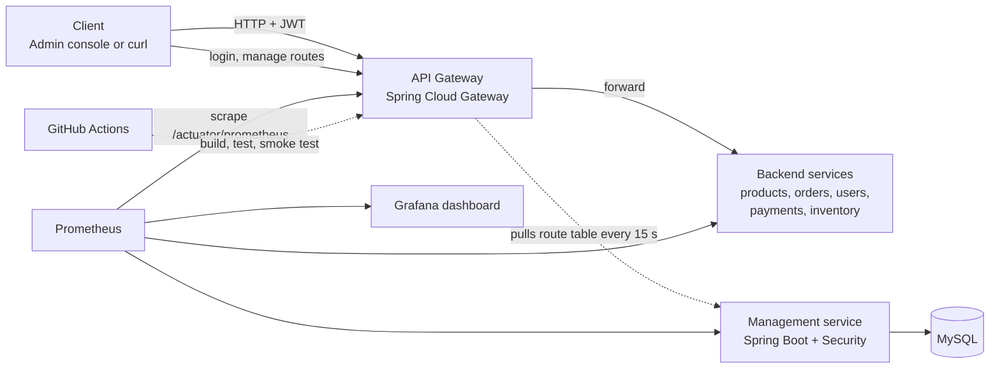

# DevOps-Driven API Gateway Management System


    

One secured entry point for backend services. Admins manage routes and rate limits from a web console,
the gateway applies changes live, and the whole system is built, tested, containerised and monitored through a DevOps pipeline.

**Team:** Bobba Snehalatha Reddy (lead), Thulasi Edhala, U Harpita, G Bhavani
**Guide:** Ms. Anjana Devi Akurathi, Dept. of CSE-HTE

New to the project? Read [docs/PROJECT_EXPLANATION.md](docs/PROJECT_EXPLANATION.md) first.

## Architecture



## Run it (needs Docker Desktop)

```
docker compose up --build
```

If port 8080 is already used on your computer, copy `.env.example` to `.env` first. The gateway then runs on port 9080.

| URL | What |
|---|---|
| http://localhost:5173 | Admin console (login `admin` / `admin123`) |
| http://localhost:8080 | Gateway (`9080` if you created `.env`) |
| http://localhost:3000 | Grafana, opens on the API Gateway overview dashboard (`admin` / `admin`) |
| http://localhost:9090 | Prometheus |

Always type `http://` in front of these addresses.

## Demo script (5 minutes)

1. `curl -i localhost:8080/products` returns **401**, because there is no token.
2. Sign in to the console (`admin` / `admin123`). Five routes are already there.
3. Click **Send request** on `product-service`. The request log shows **200**.
4. Click **Send 25 quickly** on `product-service` (limit 20 per minute). The log shows **429** and the counter "Blocked by rate limit" goes up.
5. Change the limit of `order-service` in the table, or click **Disable** on a route. Wait about 15 seconds and send a request again. The change is live with no restart.
6. Add a new route with the form. It appears in the table and goes live within 15 seconds.
7. Open Grafana. The dashboard shows requests per second, status codes, latency, 429 and 401 counts.
8. Open the GitHub Actions run. Show the green build, tests and full-stack smoke test.

## API summary

| Method | Path | Access |
|---|---|---|
| POST | /api/auth/register | public |
| POST | /api/auth/login | public, returns a JWT |
| GET | /api/routes | any logged-in user |
| POST / PUT / DELETE | /api/routes[/{id}] | ADMIN only |
| GET | /internal/routes | gateway only (shared key) |
| GET | /products, /orders, /users, /payments, /inventory | through the gateway, needs a JWT |

## Tests

- Unit test: `management-service/src/test/.../JwtServiceTest.java`
- End-to-end smoke test: `scripts/smoke-test.sh` (runs in CI; locally use Git Bash: `bash scripts/smoke-test.sh http://localhost:8080`)

## Project layout

```
management-service/   login, JWT, route CRUD, MySQL
gateway-service/      JWT check, rate limit, live routes, metrics
sample-backend/       demo services behind the gateway
frontend/             React admin console
monitoring/           Prometheus config, Grafana datasource and dashboard
scripts/              smoke test
docs/                 project explanation, review guide, slide outline
.github/workflows/    CI/CD pipeline
```
