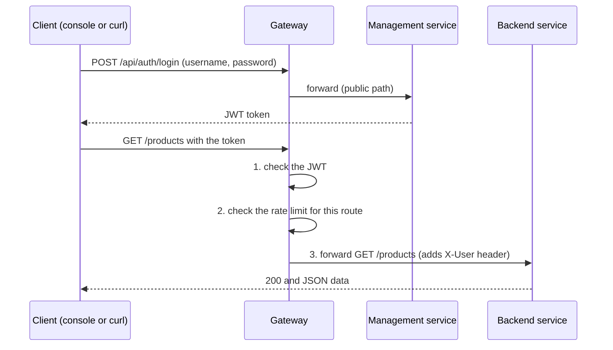

# DevOps-Driven API Gateway Management System: project explanation

This document explains, in plain language, what we built, how it works, and what we tested.
Everyone in the team should be able to explain every section.

## 1. The idea in one minute

Modern applications are split into many small services (products, orders, users, payments).
If each service had to check logins, limit traffic and publish its own address, we would repeat the same
work everywhere and any mistake would leave a hole.

An **API gateway** is one front door for all of them. Think of the reception desk of a building:

- Visitors show an ID card at reception (**JWT login token**).
- Reception counts how many times a visitor came this minute and stops anyone who is too busy (**rate limiting**).
- Reception sends the visitor to the right office (**routing**).
- The directory board at reception can be changed by an admin without closing the building (**live route management**).

Our project builds that front door, a web console to manage it, and the DevOps automation around it
(Docker, automatic testing and build on every push, and live monitoring charts).

## 2. What is in the project

| Part | What it does | Technology |
|---|---|---|
| Gateway service | The front door. Checks the token, limits requests, forwards traffic, records metrics | Java 17, Spring Boot, Spring Cloud Gateway |
| Management service | Login and registration, issues JWT tokens, stores and edits the route table | Spring Boot, Spring Security, JPA, MySQL |
| MySQL database | Stores users (passwords are hashed with BCrypt) and routes | MySQL 8 |
| Sample backend | Pretend business services (products, orders, users, payments, inventory) so the gateway has something to protect | Spring Boot |
| Admin console | Web page to sign in, see and edit routes, change limits, send test traffic | React, Vite, nginx |
| Prometheus | Collects numbers (metrics) from the services every 5 seconds | Prometheus |
| Grafana | Draws the metrics as live charts on a ready-made dashboard | Grafana |
| Docker Compose | Starts all 7 containers with one command | Docker |
| GitHub Actions | On every push: builds and tests each service, builds the images, starts the whole system and runs an end-to-end test | GitHub Actions |

## 3. How one request travels



What the gateway does, in order, for every request:

1. **Is there a valid token?** If not, answer **401** immediately. The backend never sees the request.
2. **Is this client over the route's limit this minute?** If yes, answer **429**.
3. **Forward** to the backend that the matching route points to, adding the user name in a header.
4. **Record** the result as a metric for Prometheus.

## 4. How routes change without a restart

- Routes live in MySQL, owned by the management service.
- Every 15 seconds the gateway asks the management service for the route table (`/internal/routes`,
  protected by a shared secret key so only the gateway can read it).
- If the table changed, the gateway updates its live routing and refreshes. No restart, no redeploy.
- So when an admin adds, disables, deletes a route or changes its limit in the console, the effect is live in about 15 seconds.

Trade-off we can explain: polling is simple and reliable but adds up to 15 seconds delay. A message queue could push
changes instantly (future work).

## 5. How security works

- **Login:** `POST /api/auth/login` checks the password against a BCrypt hash and returns a signed **JWT** (valid 1 hour).
- **JWT:** a signed token that carries the user name and role. The gateway can verify it with the shared secret, without a database call.
- **Two layers:** the gateway checks the token, and the management service checks it again (defence in depth).
- **Roles:** `ADMIN` can add, edit and delete routes. `USER` can only read. A normal user trying to add a route gets **403**.
- **Internal key:** the route table endpoint is for the gateway only.

## 6. How rate limiting works

- Every route has its own "requests per minute" limit, stored in the database and editable in the console.
- The gateway counts requests per route and per client address in a one-minute window. The 21st request in a minute on a route limited to 20 gets **429 Too Many Requests**.
- Demo: click **Send 25 quickly** on `product-service` (limit 20): 20 pass, 5 are blocked.

## 7. How monitoring works

```
Gateway, management and backend  ->  /actuator/prometheus  ->  Prometheus (every 5 s)  ->  Grafana dashboard
```

- Spring Boot Actuator and Micrometer expose numbers: requests per route, response codes, latency, memory, CPU.
- We added **two custom metrics** in the gateway: `gateway_auth_rejected_total` (401s) and `gateway_rate_limited_total` (429s).
  We needed them because the gateway's built-in request metric does not see requests that were blocked before routing.
- Grafana opens on the ready-made **API Gateway overview** dashboard (http://localhost:3000, login admin / admin) with 12 panels:
  services up, requests served, rate limited (429), rejected (401), requests per second by route, responses by status code,
  average latency by route, blocked requests, management API requests, JVM memory, CPU, and requests per route.

## 8. How the DevOps pipeline works

- **Docker:** each service has a Dockerfile (build with Maven or npm, then run in a small image). `docker compose up --build` starts everything.
- **GitHub Actions** (`.github/workflows/ci.yml`), on every push:
  1. Build and test the three Java services, and build their Docker images.
  2. Build the React app.
  3. **Full-stack test:** start the whole system with Docker Compose and run `scripts/smoke-test.sh`, which logs in and checks
     401 / 200 / 403 / 429 behaviour through the gateway.
- A green run means the code builds, the system starts, and the main features work.

## 9. What we have done (module-wise progress)

| Module | Status | Evidence |
|---|---|---|
| Management service (auth, roles, route CRUD, MySQL) | Done | Console login, route table loaded from MySQL |
| Gateway (JWT check, rate limit, dynamic routes, metrics) | Done | 401, 200 and 429 responses seen in the console and in the smoke test |
| Sample backend (5 services behind the gateway) | Done | `/products`, `/orders`, `/users`, `/payments`, `/inventory` |
| Admin console (React) | Done | Route table, live limit editing, test buttons, request log |
| Docker Compose deployment | Done | 7 containers running |
| CI/CD pipeline | Done | Build, test and full-stack smoke test on every push |
| Monitoring | Done | Prometheus targets and a provisioned Grafana dashboard |

## 10. Testing and results

| Test | How | Result |
|---|---|---|
| Unit test | `JwtServiceTest` creates and reads back a token | Runs in CI |
| End-to-end smoke test | `scripts/smoke-test.sh`: no token, bad token, wrong password, 5 routes with a token, admin vs normal user, rate limit | Runs in CI |
| Manual demo | Console test buttons | `/products` returned 200, then 429 after the limit |
| Monitoring check | Prometheus and Grafana | 21 requests recorded on `product-service`, plus management API calls |

Performance points to state: the dashboard shows request rate and average latency per route, JVM memory and CPU of each
service. Add your own screenshots after running the burst test.

## 11. Challenges we faced and how we solved them

| Challenge | Cause | Solution |
|---|---|---|
| Port 8080 already in use on one laptop | Another Java Windows service used it | Made the gateway port configurable (`GATEWAY_PORT`, see `.env.example`) |
| Browser error `ERR_SSL_PROTOCOL_ERROR` | Browser opened `https://` but the console is plain `http://` | Always use `http://localhost:5173` |
| Grafana looked blank at first start | It installs bundled plugins in the background | Waited, then added a provisioned dashboard that opens by default |
| CI full-stack test failed | The test called port 8080 while the local-port change had moved the gateway to 9080 in the committed file | Port now defaults to 8080 and only changes through `.env`, which is not committed |
| 401 and 429 missing from Grafana | They are blocked before the gateway's built-in metric runs | Added custom counters for them |
| Every file shown as changed in git on Windows | Different line endings | Added `.gitattributes` |

## 12. What is different or innovative

- Routes, limits and users are data, not code: change them live from a console.
- One system covers security, routing, rate limiting, DevOps automation and observability together, using only free open-source tools.
- The pipeline starts the entire system and tests it end to end on every push.
- Custom metrics make blocked traffic visible, which most basic gateway setups hide.

## 13. Limitations and future work

- Route changes take up to 15 seconds (polling). Future: push updates with a message queue.
- The rate limiter keeps counts in memory, so it suits one gateway instance. Future: Redis for several instances.
- Demo secrets are in `docker-compose.yml`. Future: proper secret storage.
- No HTTPS. Future: TLS at the gateway.
- Future: circuit breaker, request logging to a database, Kubernetes deployment, refresh tokens.

## 14. Glossary for the review

- **API gateway:** a single entry point that sits in front of backend services.
- **Route:** a rule saying "requests for this path go to that service".
- **JWT:** a signed token that proves who you are without asking the database every time.
- **Rate limiting:** capping how many requests a client may send in a time window.
- **Microservice:** a small service that does one business job.
- **CI/CD:** automatically building, testing and delivering code on every change.
- **Docker / container:** a packaged app that runs the same everywhere.
- **Prometheus:** a tool that collects and stores numeric metrics.
- **Grafana:** a tool that draws metrics as dashboards.
- **Observability:** being able to see what the system is doing from the outside.
